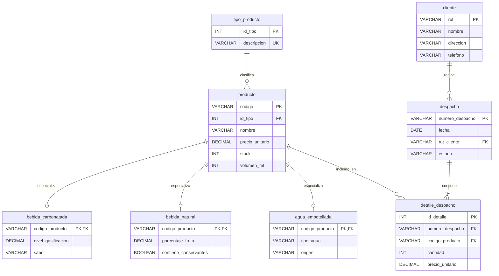

# Modelo Entidad-Relación (MER) — Embotelladora Los Andes (3FN)

Coherente con `scripts/embotelladora_mysql.sql`.

## Justificación de Normalización (3FN)

1. **1FN:** Todos los atributos son atómicos, cada tabla tiene `PRIMARY KEY` y los ítems de cada despacho se separan en `detalle_despacho`.
2. **2FN:** No existen dependencias parciales porque todas las tablas tienen clave primaria simple (`codigo`, `rut`, `numero_despacho`, `id_detalle`).
3. **3FN:**
    - Los atributos propios de cada tipo de bebida se separan en 3 tablas 1:1 (`bebida_carbonatada`, `bebida_natural`, `agua_embotellada`), eliminando columnas `NULL` dependientes del tipo.
    - `tipo_producto` evita repetir nombres de categorías en `producto`.
    - No se almacenan campos calculados (`total`, `subtotal`, `total_unidades`).
    - `detalle_despacho.precio_unitario` guarda el precio histórico congelado del despacho (depende de `id_detalle`, no transitivamente de `producto`).
    - `ON DELETE RESTRICT` impide borrar productos o clientes que tengan despachos asociados.